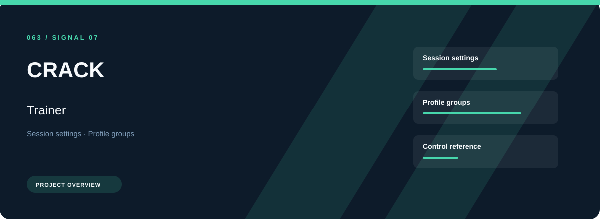
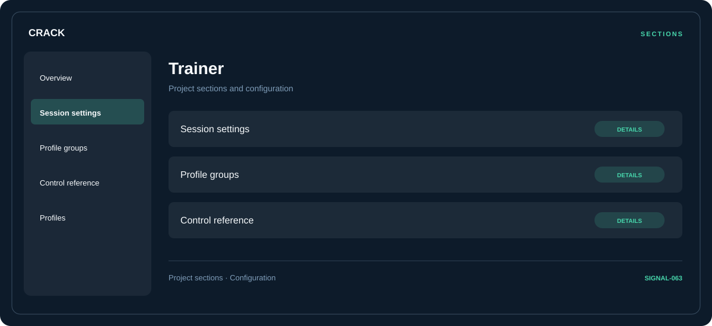

# 🧭 CRACK Trainer

**Session settings · Profile groups · Control reference**

## ⚡ Features

CRACK Trainer focuses on three connected areas: session settings, profile groups, control reference. Its organization keeps frequently used options close to the context they belong to.

### ⚙️ Session settings

Session and activity information grouped by the task or context it belongs to.

### 🧩 Profile groups

Related settings collected into named groups for a clearer configuration workflow.

### ⌨️ Control reference

A dedicated section for control reference and the configuration details associated with that area.

## 🖥️ Project navigation

## 📥 Download

The button and cover open the project's download page. Use the information supplied with the downloaded package for installation and release-specific requirements.

## 📚 Project documentation

- [Feature reference](docs/FEATURES.md)
- [Download information](docs/DOWNLOAD.md)
- [Project page](index.html)

---

CRACK Trainer · Program documentation and download information.
